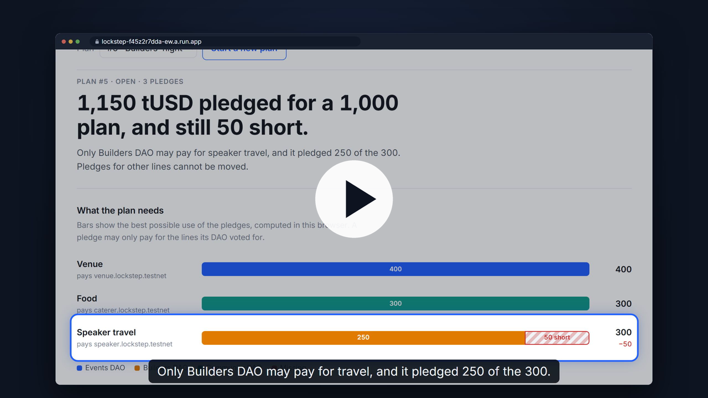
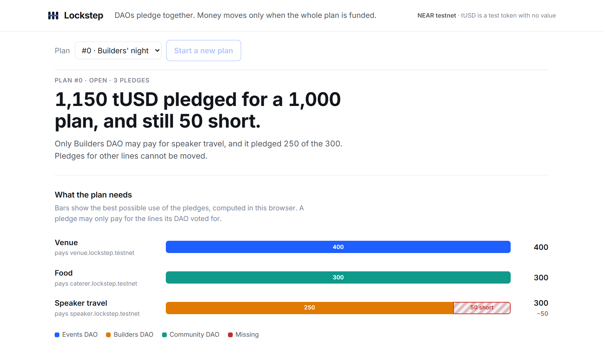
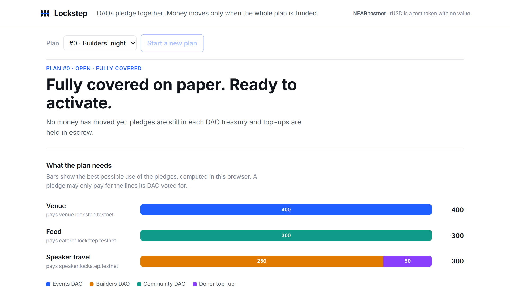
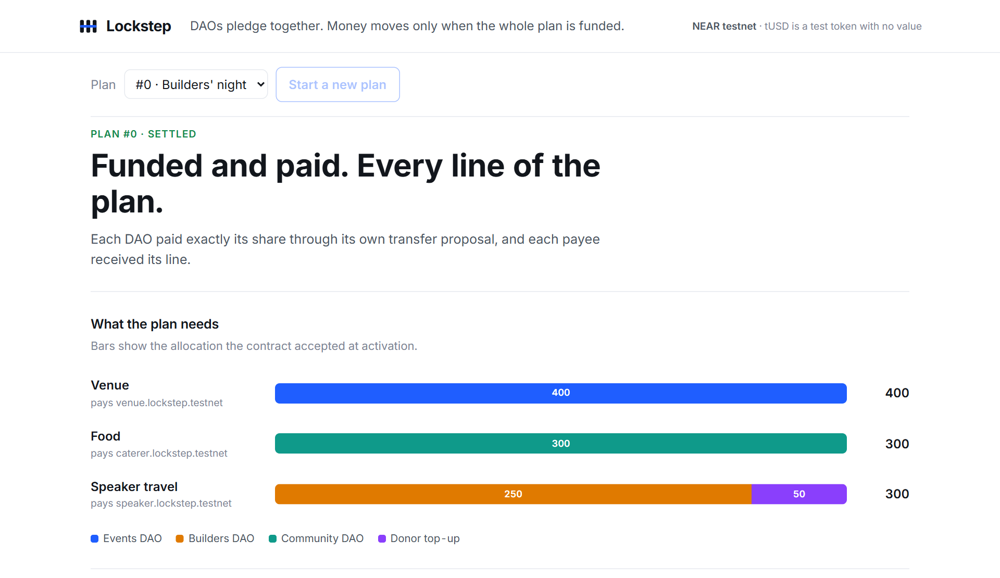
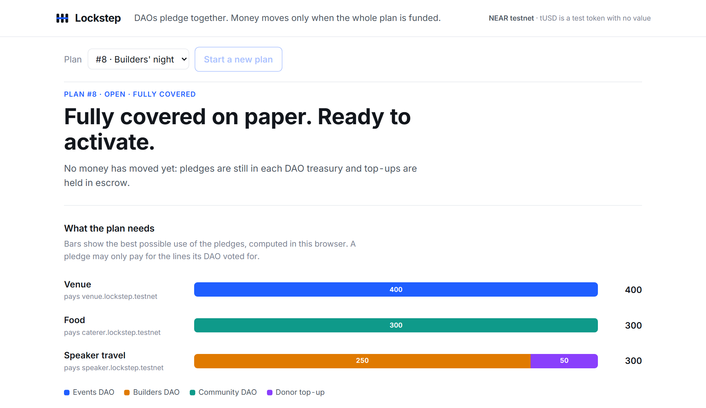
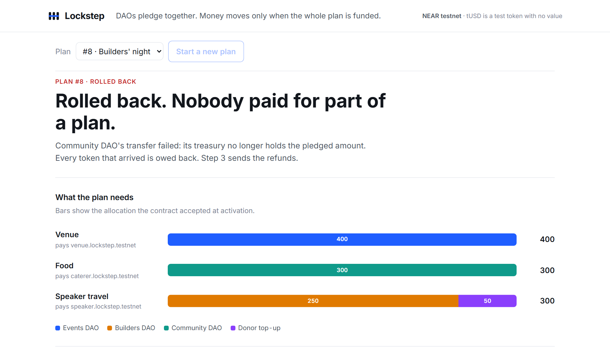
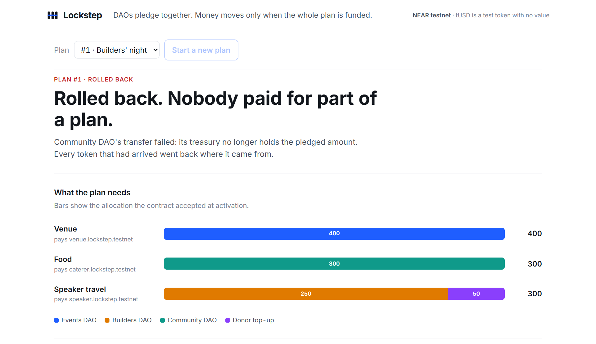
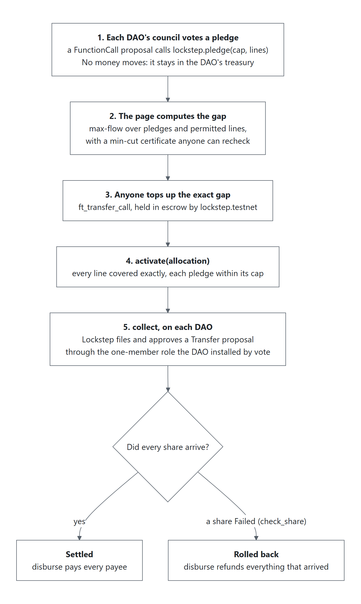
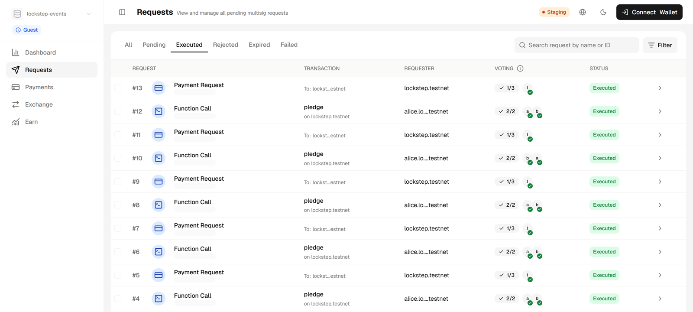
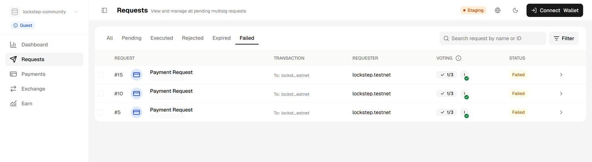

[](https://github.com/Marc-Dvci/lockstep/actions/workflows/ci.yml)
[](https://github.com/Marc-Dvci/lockstep/actions/workflows/live.yml)
[](https://github.com/Marc-Dvci/lockstep/actions/workflows/codeql.yml)


[](LICENSE)
[](https://lockstep-f45z2r7dda-ew.a.run.app)

[](https://youtu.be/Fvwn0QpIKu0)

**Watch the film (2:00): https://youtu.be/Fvwn0QpIKu0**

# Lockstep

**Community DAOs pledge to a shared plan. Money moves only when the whole plan is funded, and the page shows the exact amount and category that would complete it.**

I built Lockstep solo at NEAR HACKATHON. I am Marc Donovici, a technology auditor, so every plan it runs can be rechecked from public chain data, without keys.

| Try it | Tracks | Built with | On chain on 5 November |
| --- | --- | --- | --- |
| [Live demo, no account](https://lockstep-f45z2r7dda-ew.a.run.app) · [the film, 2:00](https://youtu.be/Fvwn0QpIKu0) · `npm run verify` | Social Money (`social`), Real-World Money (`realworld`) | Rust `near-sdk` 5.30 · Sputnik DAO v2 · NEP-141 · `near-api-js` 7.4 | 9 plans: 4 settled, 4 rolled back, 1 open; `verify` 65 passed, 0 failed |

[For judges](#for-judges) · [See it work](#see-it-work) · [The problem](#the-problem) · [How it works](#how-it-works) · [What NEAR does here](#what-near-does-here) · [Trust boundary](#trust-boundary-what-it-will-not-do) · [Evidence](#evidence) · [Run it](#run-it)

## For judges

Code links point at the submitted release, `v1.0.0`.

| Criterion | What to inspect | Where |
| --- | --- | --- |
| Technical implementation | The DAO's own vote is the pledge; Lockstep files and approves each share as a Transfer proposal on the DAO through a role the council installed, then reads `Failed` back and refunds | [`pledge`](https://github.com/Marc-Dvci/lockstep/blob/v1.0.0/contract/src/lib.rs#L275-L294), [`activate`](https://github.com/Marc-Dvci/lockstep/blob/v1.0.0/contract/src/lib.rs#L308-L355), [`collect`](https://github.com/Marc-Dvci/lockstep/blob/v1.0.0/contract/src/lib.rs#L362-L374) and [its policy check](https://github.com/Marc-Dvci/lockstep/blob/v1.0.0/contract/src/lib.rs#L377-L422), [`check_share`](https://github.com/Marc-Dvci/lockstep/blob/v1.0.0/contract/src/lib.rs#L468-L493), [`ft_on_transfer`](https://github.com/Marc-Dvci/lockstep/blob/v1.0.0/contract/src/lib.rs#L571-L602); 21 contract tests, 5 sandbox end-to-end tests with real DAO votes |
| Design | One sentence says what completes the plan ("50 for speaker travel completes it; 50 for food would not"); councils see every step as an ordinary proposal in their treasury app | Gap engine [`solve`](https://github.com/Marc-Dvci/lockstep/blob/v1.0.0/core/gap.js#L113-L140) and [`completions`](https://github.com/Marc-Dvci/lockstep/blob/v1.0.0/core/gap.js#L185-L200); [See it work](#see-it-work); [Trezu screens](#seen-from-the-councils-treasury-app-trezu) |
| Impact | Shared funding that today is settled in chat: "we pay if they pay" becomes enforceable, and a failed share refunds everyone | [The problem](#the-problem); [the plans on chain](#evidence) |
| Originality | A max-flow with a min-cut certificate decides what the pledges can legally cover, and anyone can recheck it without running an optimizer | [`verifyCertificate`](https://github.com/Marc-Dvci/lockstep/blob/v1.0.0/core/gap.js#L146-L178); the contract accepts any feasible allocation and does not trust the engine |
| Sustainability | The contract has no access keys; `npm run verify` rechecks every plan from public data, and runs every six hours during judging | [`scripts/verify.js`](https://github.com/Marc-Dvci/lockstep/blob/v1.0.0/scripts/verify.js); [live check](https://github.com/Marc-Dvci/lockstep/actions/workflows/live.yml) |

## See it work

Captured from the hosted demo on 5 November 2026, driven in a headless browser through both stories on NEAR testnet (plans #7 and #8). Full pages are in [docs/screens](docs/screens).

| | |
| --- | --- |
|  |  |
| **Pledged, and still short.** Only Builders DAO may pay for travel. | **50 for travel completes it.** A donor's top-up is held in escrow. |
|  |  |
| **Settled.** Each DAO paid its share through its own transfer proposal. | **Same plan again**, but one council spends its money elsewhere first. |
|  |  |
| **Rolled back.** The DAO marked its transfer `Failed`; Lockstep read it back. | **Refunded.** Every token that arrived went back where it came from. |

## The problem

Three community DAOs want to fund a builders' night together: venue 400, food 300, speaker travel 300. Each council can only fund certain things. Between them they pledge 1,150, more than the 1,000 the evening costs, and it still cannot happen. Only one DAO may pay for travel, and it pledged 250 of the 300. Today this gets sorted out in chat. Each council waits for the others, nobody can enforce "we pay if they pay", and nothing returns the money if the plan falls through.

With Lockstep:

- Each DAO votes **once** on a pledge, as an ordinary Sputnik proposal. No money moves.
- The page says **"50 tUSD for speaker travel completes it. The same amount for venue or food would not."** That sentence is computed with max-flow and backed by a min-cut certificate that anyone can recheck.
- Anyone fills the gap with a top-up, which is held in escrow.
- On activation, Lockstep pulls each DAO's share through a transfer proposal on the DAO itself, filed and approved by a role the DAO installed.
- If every share arrives, the payees are paid. **If any share fails, everything that arrived goes back to where it came from.** Nobody pays for part of a plan.

## How it works



| Method | Who | What it checks or does |
| --- | --- | --- |
| `create_plan(title, token, lines, open_for_sec)` | anyone, 0.1 NEAR storage deposit | 1–8 cost lines, each with a payee; accepted token only. |
| `pledge(plan_id, cap, lines, expires_in_sec?)` | a DAO created by an accepted factory, via its own `FunctionCall` proposal | Replaces that DAO's earlier pledge; no money moves. `withdraw_pledge` while open. |
| `ft_on_transfer` with `{"topup":{"plan_id","lines"}}` | the accepted token | Escrowed top-up; refunded if the plan does not settle, unused part refunded if it does. |
| `activate(plan_id, allocation)` | anyone | Every line covered exactly; every amount within its pledge or top-up and its permitted lines; no expired pledge. |
| `collect(plan_id, funder)` | anyone | Reads the DAO's policy (exact proposal bond, Lockstep role present), files the transfer proposal, approves it. |
| `ft_on_transfer` with `{"share":{"plan_id"}}` | the accepted token, sender = a DAO with a pending share | Amount must equal the share. A council may also send its share by an ordinary vote. |
| `check_share(plan_id, funder)` | anyone | Reads the DAO's proposal; `Failed`, `Rejected`, `Removed` or `Expired` fails the share. `Approved` changes nothing, because the transfer may still be in flight. |
| `finalize(plan_id)` | anyone | Expires an open plan past its deadline, or rolls back missing shares after the 10-minute collection window. |
| `disburse(plan_id)` | anyone | Sends up to 8 pending claims per call. A failed transfer leaves its claim pending for retry; a claim is never paid twice. |

A plan moves from `Open` to `Collecting` on activation, then to `Settled` when every share arrived, or to `RolledBack` when one failed or the collection window closed. An open plan past its deadline becomes `Expired`. `disburse` then pays the payout or refund claims.

The gap engine ([core/gap.js](core/gap.js)) is the same file in Node and in the browser:

- `solve` computes the most the pledges can legally cover (a maximum flow on pledge → permitted line → plan), an allocation, and the minimum cut that proves no allocation does better.
- `completions` finds, for each line, the smallest top-up restricted to that line alone that completes the plan, or reports that none does.
- `verifyCertificate` checks an allocation and a cut without running any optimizer.

The contract does not trust the engine: it accepts any allocation that is feasible and covers every line exactly.

The demo page ([web/](web)) runs the demo accounts' actions through a small Node server. It queues one chain job at a time, reads through two RPC endpoints with failover, and retries rate-limited reads.

## What NEAR does here

| NEAR piece | What it does in Lockstep |
| --- | --- |
| **Sputnik DAO v2** (the code `sputnikv2.testnet` deploys today, v3.31) | Each DAO keeps custody and its own council. A **`FunctionCall` proposal** is the pledge: the council's vote calls `lockstep.pledge(...)`, so the caller *is* the DAO. A **`ChangePolicyAddOrUpdateRole` proposal** installs a one-member `lockstep` role limited to `transfer:AddProposal` and `transfer:VoteApprove`. |
| **Transfer proposals with `msg`** | To collect a share, Lockstep files `Transfer { token_id, receiver_id: lockstep, amount, msg: {"share":{"plan_id":N}} }` on the DAO and approves it with its role. Sputnik executes `ft_transfer_call`, and Lockstep's `ft_on_transfer` records the arrival with `sender_id` = the DAO. If the treasury no longer holds the money, Sputnik marks the proposal `Failed`, and Lockstep reads that back with `check_share`. |
| **NEP-141** | One accepted token per deployment (tUSD, a test token with no value). Top-ups arrive by `ft_transfer_call`; payouts and refunds leave by `ft_transfer`. |
| **Named accounts** | Every pledge, share, proposal and claim names the DAO, payee or donor account. |
| **NEP-330** | The contract publishes its source link and version (`contract_source_metadata`). |

Lockstep does not replace the multisig. Each treasury keeps its council, its voting rules and its money until the moment a fully funded plan settles.

### Seen from the council's treasury app (Trezu)

Everything Lockstep does on a DAO is an ordinary Sputnik proposal, so a council sees it in the treasury app it already uses. The hosted [Trezu](https://github.com/NEAR-DevHub/trezu) is mainnet-only. These screenshots come from Trezu's own testnet dev mode (`nt-fe`, `bun run testnet:mock`, commit `7b063dd`), run locally on 3 November 2026 against the demo DAOs above, viewed as a guest:

- **Events DAO, Executed tab:** each pledge is a `pledge` function call on `lockstep.testnet`, voted 2/2 by the council. Each share is a Payment Request filed by `lockstep.testnet` through its role.

  

- **Community DAO, Failed tab:** the shares that failed after its council spent the money elsewhere. Lockstep reads exactly this status back, then rolls the plan back.

  

## Trust boundary: what it will not do

- A DAO that installs the role trusts Lockstep's code to file and approve transfer proposals **to Lockstep only, for shares its council pledged by vote**. Lockstep enforces the pledge caps; Sputnik cannot express an amount limit on a role.
- Tokens sit in Lockstep only between collection and payout, or as escrowed top-ups until the plan closes.
- A pledge is not a lock. A DAO can spend the money elsewhere before activation; the plan then rolls back and nobody pays. The demo shows this on purpose.
- A proposal bond is attached by Lockstep when it files a share's transfer proposal. Sputnik returns it when the proposal succeeds and keeps it when the transfer fails, so each rolled-back share costs the Lockstep account one bond (1 NEAR on the demo DAOs). The demo server pauses the failure demo when the contract runs low; anyone can send it testnet NEAR.
- Funded, paid and delivered are different things. Lockstep records the first two; whether the evening took place is outside the chain.

## Evidence

> [!IMPORTANT]
> The contract, the DAOs, every vote and every transfer are real NEAR testnet transactions. tUSD is a test token with no value, and the councils, donor and payees are demo accounts.

### Live on NEAR testnet

| Account | Role |
| --- | --- |
| [`lockstep.testnet`](https://testnet.nearblocks.io/address/lockstep.testnet) | The Lockstep contract. **It has no access keys** (deleted in [J2pEK9vV…](https://testnet.nearblocks.io/txns/J2pEK9vVtS1rCurwmP8cXujyThSxcuGiE4m6hJq15fq4)), so nobody can redeploy it or sign for it. |
| [`tusd.lockstep.testnet`](https://testnet.nearblocks.io/address/tusd.lockstep.testnet) | tUSD, a NEP-141 test token with no value (6 decimals). |
| [`lockstep-events.sputnikv2.testnet`](https://testnet.nearblocks.io/address/lockstep-events.sputnikv2.testnet), [`lockstep-builders…`](https://testnet.nearblocks.io/address/lockstep-builders.sputnikv2.testnet), [`lockstep-community…`](https://testnet.nearblocks.io/address/lockstep-community.sputnikv2.testnet) | Three demo DAOs created through the `sputnikv2.testnet` factory, each with a two-member council and the Lockstep role installed by council vote. |

The two stories, as first run on chain:

| Plan | What happened | Transactions |
| --- | --- | --- |
| #1, settled | Three pledges (500 venue, 250 travel, 400 food or venue) and a 50 travel top-up. Activation, then three transfer proposals filed and approved by Lockstep, one on each DAO. Payees paid 400, 300, 300. | [top-up](https://testnet.nearblocks.io/txns/AHsmP9DLDwG4TCNJLeykjvr1mW7sUAZeU9sZbWaiTCCk) · [activate](https://testnet.nearblocks.io/txns/GS4zJbLSLhpkHyKVtSyaX7TYh7yXjq8gMTNgbeskjKvj) · collect [Events](https://testnet.nearblocks.io/txns/CMBVcT3WWNPCEV971Wr8qUQp3hP7iv31AJrN62W1yi11), [Builders](https://testnet.nearblocks.io/txns/5EMVPabzyWdU73JeVGJDMfUr7dgPHMV25NxqhjDkNYSK), [Community](https://testnet.nearblocks.io/txns/AZZnrDJuhCAGZdagm5WLckBL8Xu5S9TRttkBeYFV9T5J) · [pay out](https://testnet.nearblocks.io/txns/Eu8dW7oSUma8sXoXsqyq7QGrEssCERLY8yeyFhjBhBFF) |
| #2, rolled back | Same pledges and top-up. Before activation, Community DAO's council [paid 250 elsewhere](https://testnet.nearblocks.io/txns/8aE33gQyj7rFVK26kr1Z4Ev7ATC7SDF1iA8sMJE7rio). Its share transfer failed inside the DAO ("The account doesn't have enough balance"), the DAO marked the proposal `Failed`, and Lockstep read that back and rolled the plan back. Events DAO got 400 back, Builders DAO 250, the donor 50. | [activate](https://testnet.nearblocks.io/txns/8BfiNWkDz3CzVkav1be2gPRYHirPjBcVZPmnjXWuW5de) · collect [Events](https://testnet.nearblocks.io/txns/Gexcnqmkf2iQdAvu6MBL9QQrRLPrBrTLM8UKiCzsv8jU), [Builders](https://testnet.nearblocks.io/txns/43Q3CjjHckRLhSfV2xL7TksoVVL9Ai8BLFyRe1bLiKLb), [Community (fails)](https://testnet.nearblocks.io/txns/D8r1FbogVTV3YnDNTwoxuK1nNtvzwBe4uA6F3NL5f9Y3) · [check_share](https://testnet.nearblocks.io/txns/HHbnpxJDi2nkjw8MBig1Y1mPGE1UnX748Kn7gckxDqNP) · [refunds](https://testnet.nearblocks.io/txns/636yAtixjnQ4MUCq6UUFCg2azVhU9uVVv5bzXUA8c7kS) |

Plans #3 to #8 repeat the same two stories through the demo page: #3, #5 and #7 settled; #4, #6 and #8 rolled back. #7 and #8 ran on the hosted demo on 5 November. Plan #0 is open with two pledges, and `verify` checks its certificate like any other open plan.

### What `verify` checks

`scripts/verify.js` reads only public chain state:

- The contract publishes NEP-330 source metadata. On testnet, it also has no access keys.
- The deployed code hash is compared with your local build.
- Each DAO's Lockstep role is a one-member group limited to `transfer:` permissions.
- For each open plan, the gap is recomputed and its min-cut certificate checked.
- For each activated plan:
  - the accepted allocation covers every line exactly, within each pledge's cap and permitted lines;
  - every share is matched with the DAO's own proposal (proposer, receiver, token, amount, plan id in `msg`, and status `Approved` / `Failed`);
  - everything that arrived is owed out, as payouts plus unused top-ups, or as refunds;
  - escrow equals unpaid claims.
- The contract's token balance covers what it owes across all plans.

### Claims and the tests behind them

33 tests: 7 for the gap engine, 21 for the contract, 5 end-to-end on a local sandbox with real Sputnik DAOs and real votes. The gap engine's tests cover 100% of its lines and 89% of its branches (`npm run coverage`; CI fails below 95% of lines or 85% of branches). The contract's tests cover 90.8% of the lines of `contract/src/lib.rs` (`cargo llvm-cov -p lockstep`; CI fails below 85%).

| Claim | Code | Test |
| --- | --- | --- |
| 1,150 pledged, 50 short on travel: 50 travel completes it, 49 leaves 1, 50 food changes nothing | [core/gap.js](core/gap.js) | [gap tests](core/gap.test.js#L16-L40), [e2e](tests/e2e.test.js#L108) |
| The engine agrees with exhaustive cut enumeration; tampered or stale certificates are rejected | [core/gap.js](core/gap.js) | [500 random plans](core/gap.test.js#L68), [tampering](core/gap.test.js#L50) |
| Activation with a gap, over a cap or outside a pledge's lines is refused | [lib.rs](contract/src/lib.rs) | [`gap_blocks_activation`](contract/src/tests.rs#L88), [`restriction_enforced`](contract/src/tests.rs#L103), [`cap_enforced`](contract/src/tests.rs#L119) |
| Only DAO accounts pledge; a foreign token is refused | [lib.rs](contract/src/lib.rs) | [`only_dao_accounts_pledge`](contract/src/tests.rs#L127), [`foreign_token_refused`](contract/src/tests.rs#L135) |
| One failed share rolls the plan back, and waiting shares are not pulled | [lib.rs](contract/src/lib.rs) | [`one_failed_share_rolls_everything_back`](contract/src/tests.rs#L170), [`refused_proposal_fails_fast_without_pulling_other_shares`](contract/src/tests.rs#L197), [e2e](tests/e2e.test.js#L162) |
| An in-flight transfer reported `Approved` is not mistaken for a failure | [lib.rs](contract/src/lib.rs) | [`in_flight_transfer_is_not_mistaken_for_failure`](contract/src/tests.rs#L355) |
| A share cannot arrive twice or with a different amount; no double activation or collect | [lib.rs](contract/src/lib.rs) | [`share_cannot_arrive_twice`](contract/src/tests.rs#L215), [`share_amount_must_match`](contract/src/tests.rs#L226), [`no_double_activation`](contract/src/tests.rs#L236), [`no_double_collect`](contract/src/tests.rs#L246) |
| A DAO without the role fails cleanly with a stated reason and loses nothing | [lib.rs](contract/src/lib.rs) | [e2e](tests/e2e.test.js#L205), [`role_detection_accepts_wildcards_and_rejects_strangers`](contract/src/tests.rs#L378) |
| Spoofed tokens, non-DAO pledges and fake shares sent through the real token are refused and refunded | [lib.rs](contract/src/lib.rs) | [e2e](tests/e2e.test.js#L224) |
| A failed payout stays retryable and pays once; a duplicate callback is rejected | [lib.rs](contract/src/lib.rs) | [`claims_pay_once_and_failed_transfers_stay_retryable`](contract/src/tests.rs#L290), [`duplicate_claim_callback_rejected`](contract/src/tests.rs#L317) |
| Expiry before activation refunds top-ups; a closing collection window rolls back | [lib.rs](contract/src/lib.rs) | [`unactivated_plan_expires_and_refunds_top_ups`](contract/src/tests.rs#L270), [`window_closes_and_missing_shares_roll_back`](contract/src/tests.rs#L256) |
| The hosted page runs both stories with no page error, at 1280 px and at 390 px | [web/](web) | [UI drive](tests/ui.drive.js), [its report](docs/screens/drive-report.json) |

### Measured

On NEAR testnet, through the hosted demo (5 November 2026, headless browser, [drive report](docs/screens/drive-report.json)):

| What | Measured |
| --- | --- |
| Preparing a demo plan: 4 mints, the plan, 3 pledge proposals with 2 council votes each | 47.7 s and 56.7 s |
| Top-up, from click to final | 6.6 s and 6.7 s |
| Activate | 4.4 s |
| Collecting three shares (settled plan) | 31.1 s |
| A council spending 250 elsewhere: proposal and two votes | 14.9 s |
| Collecting three shares, one of which fails, plus the status check (rolled-back plan) | 41.3 s |
| Paying out three claims | 6.7 s |

On the local sandbox (3 November 2026):

| What | Measured |
| --- | --- |
| Gas burnt by one `collect` transaction, all receipts included (policy read, proposal, approval, DAO transfer, arrival) | 27 Tgas, for each of the 3 DAOs |
| Collecting three shares, one after another, waiting for final blocks each time | 28.6 s |
| Preparing a demo plan (4 mints, the plan, 3 pledge proposals with 2 council votes each) | 53–55 s |
| Contract size | 241 KB (`cargo near build non-reproducible-wasm`) |

## Run it

### Without installing anything

Open the [live demo](https://lockstep-f45z2r7dda-ew.a.run.app) and click **Start a new plan**. About a minute later a plan with three DAO pledges appears, each voted by a two-member council. Then follow the page: top up 50 for travel, then **1 · Activate**, **2 · Collect shares** and **3 · Pay out**. **Community DAO spends 250 elsewhere** shows the rollback. The demo runs on Google Cloud Run; after a quiet spell, the first request takes a few seconds while it starts.

### Check every plan without keys (testnet)

```bash
git clone https://github.com/Marc-Dvci/lockstep && cd lockstep && npm ci
npm run verify
```

Expected last line: `N passed, 0 failed`. N grows with the number of plans: it was `65 passed, 0 failed` with the 9 plans on chain on 5 November, and every plan someone runs on the hosted demo adds checks. The first line confirms that `lockstep.testnet` has 0 access keys. If you build the contract (`npm run build`), the script also compares your build's hash with the deployed code hash. On 3 November both were `h3DSKfgiqkEMDHZtqYRs1BRiWhfi1DThNoSdyPf4zsg`.

### The page, read-only, without keys

```bash
NETWORK=testnet npm start          # or: docker compose up
```

Expected: `Lockstep demo on http://127.0.0.1:8787 (testnet, contract lockstep.testnet, read-only)` (port 7860 with Docker). The page shows every live plan on testnet; its action buttons are off, and the server answers that this copy is read-only.

### The whole flow on a local sandbox

The demo runs against a local NEAR sandbox (nearcore 2.14.0, protocol 88, the same protocol as testnet) with the same Sputnik DAO code as testnet.

Requirements: Node 22+, Rust with `wasm32-unknown-unknown`, [cargo-near](https://github.com/near/cargo-near) 0.22, and a Linux or WSL2 shell for the sandbox binary (NEAR publishes it for Linux and macOS only).

| Do | See |
| --- | --- |
| `npm ci` | Dependencies installed (`near-api-js` 7.4.0). |
| `npm test` | `pass 7`: the gap engine, including 500 random plans checked against exhaustive cut enumeration. |
| `cargo test -p lockstep` | `21 passed`: contract logic, with the cross-contract callbacks simulated. On Windows, set `AWS_LC_SYS_PREBUILT_NASM=1` for the test-only dependency. |
| `npm run build` | `target/near/lockstep/lockstep.wasm` and `target/near/tusd/tusd.wasm`. |
| In Linux/WSL: `bash tests/sandbox.sh` | A fresh sandbox on `127.0.0.1:3030`; the root key is copied to `/tmp/lockstep-sandbox-root-key.json`. On glibc older than 2.39, point `GLIBC_DIR` at an extracted libc6 2.39 tree (see the script). |
| Copy that key to `tests/res/sandbox-root-key.json`, then `npm run test:e2e` | `pass 5`: real Sputnik DAOs, real votes, settle, roll back, missing role, spoofing attempts. |
| `npm run seed -- sandbox`, then `NETWORK=sandbox npm start` | `Lockstep demo on http://127.0.0.1:8787`. |
| Open it and click **Start a new plan** | About a minute later, a coordinator's plan with three DAO pledges, each voted by a two-member council. The headline reads **"1,150 tUSD pledged for a 1,000 plan, and still 50 short."** |
| Choose *Food* and amount 50 in "What completes it" | **"This would not help: that line is already covered."** |
| Choose *Speaker travel*, then click **Top up as the demo donor** | The headline turns to **"Fully covered on paper. Ready to activate."** |
| Click **1 · Activate**, then **2 · Collect shares** | Three transfer proposals are filed and approved on the three DAOs; the headline reads **"Every share arrived. The plan is settled."** |
| Click **3 · Pay out** | **"Funded and paid."** Venue 400, caterer 300, speaker 300. Every line under "Checked in this browser" is ticked. |
| Click **Start a new plan**, top up 50 for travel, click **Community DAO spends 250 elsewhere**, then Activate and Collect | **"Rolled back. Nobody paid for part of a plan."** Community DAO's proposal is marked `Failed` by the DAO itself; Events and Builders DAO are owed 400 and 250 back, the donor 50. |
| Click **3 · Pay out** | Every refund is shown as *Paid*. Each DAO treasury is back where it started. |
| `npm run verify -- sandbox` | `21 passed, 0 failed`: every plan on your sandbox checked against chain state. |

With the demo server running, `CHROME=<path to a Chromium or chrome-headless-shell> npm run test:ui` drives the same two stories in headless Chromium and fails on any page error. It checks the page at 1280 px and at 390 px (no horizontal scroll). `BASE=<url>` points it at another server, such as the hosted demo.

### Hosting

The hosted demo is this repository's [Dockerfile](Dockerfile) on Google Cloud Run, deployed by [deploy/cloudrun.sh](deploy/cloudrun.sh). It runs one instance at most, so chain jobs never race, and reads the demo accounts from Secret Manager.

## Built with

- Contract: Rust, `near-sdk` 5.30.0. Test token: `near-contract-standards` 5.30.0.
- Scripts, demo server and page: Node, `near-api-js` 7.4.0, no framework. UI drive: `playwright-core`. Lint: ESLint.
- Sputnik DAO v2 code for tests: [near-daos/sputnik-dao-contract @ 7764926c](https://github.com/near-daos/sputnik-dao-contract/tree/7764926cfd3c47f62b5fcde231c251f3c3892887), fetched by `scripts/fetch-sputnik.js` and checked against SHA-256 `880bae9a…952da`. That is the code `sputnikv2.testnet` deploys by default (version [3,31]).

**Baseline disclosure:** every file in this repository was written during the event, starting 3 November 2026. No earlier code of the author's is used.

## Other entry

My other NEAR HACKATHON entry is LIFO (https://github.com/Marc-Dvci/lifo), in Memecoins With Mechanics; the two share no code.

## License

MIT, see [LICENSE](LICENSE).
