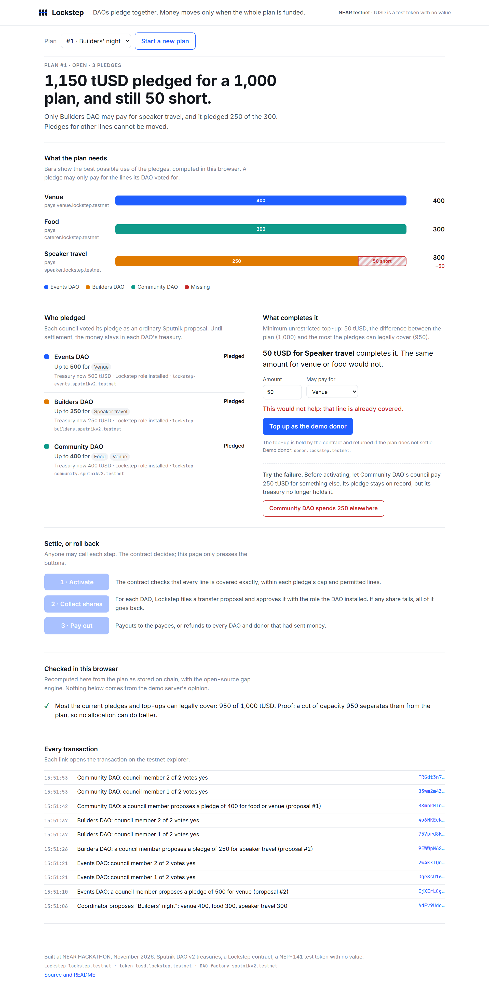

# Lockstep

**Community DAOs pledge to a shared plan. Money moves only when the whole plan is funded, and the page shows the exact amount and category that would complete it.**

Three community DAOs want to fund a builders' night together: venue 400, food 300, speaker travel 300. Each council can only fund certain things. Between them they pledge 1,150, more than the 1,000 the evening costs, and it still cannot happen. Only one DAO may pay for travel, and it pledged 250 of the 300. Today this gets sorted out in chat. Each council waits for the others, nobody can enforce "we pay if they pay", and nothing returns the money if the plan falls through.

With Lockstep:

- Each DAO votes **once** on a pledge, as an ordinary Sputnik proposal. No money moves.
- The page says **"50 tUSD for speaker travel completes it. The same amount for venue or food would not."** That sentence is computed with max-flow and backed by a min-cut certificate that anyone can recheck.
- Anyone fills the gap with a top-up, which is held in escrow.
- On activation, Lockstep pulls each DAO's share through a transfer proposal on the DAO itself, filed and approved by a role the DAO installed.
- If every share arrives, the payees are paid. **If any share fails, everything that arrived goes back to where it came from.** Nobody pays for part of a plan.

Built at NEAR HACKATHON (1–14 November 2026). Tracks: Social Money (`social`), Real-World Money (`realworld`).



## Live on NEAR testnet

| Account | Role |
| --- | --- |
| [`lockstep.testnet`](https://testnet.nearblocks.io/address/lockstep.testnet) | The Lockstep contract. **It has no access keys** (deleted in [J2pEK9vV…](https://testnet.nearblocks.io/txns/J2pEK9vVtS1rCurwmP8cXujyThSxcuGiE4m6hJq15fq4)), so nobody can redeploy it or sign for it. |
| [`tusd.lockstep.testnet`](https://testnet.nearblocks.io/address/tusd.lockstep.testnet) | tUSD, a NEP-141 test token with no value (6 decimals). |
| [`lockstep-events.sputnikv2.testnet`](https://testnet.nearblocks.io/address/lockstep-events.sputnikv2.testnet), [`lockstep-builders…`](https://testnet.nearblocks.io/address/lockstep-builders.sputnikv2.testnet), [`lockstep-community…`](https://testnet.nearblocks.io/address/lockstep-community.sputnikv2.testnet) | Three demo DAOs created through the `sputnikv2.testnet` factory, each with a two-member council and the Lockstep role installed by council vote. |

Two complete stories are on chain:

| Plan | What happened | Transactions |
| --- | --- | --- |
| #1, settled | Three pledges (500 venue, 250 travel, 400 food or venue) and a 50 travel top-up. Activation, then three transfer proposals filed and approved by Lockstep, one on each DAO. Payees paid 400, 300, 300. | [top-up](https://testnet.nearblocks.io/txns/AHsmP9DLDwG4TCNJLeykjvr1mW7sUAZeU9sZbWaiTCCk) · [activate](https://testnet.nearblocks.io/txns/GS4zJbLSLhpkHyKVtSyaX7TYh7yXjq8gMTNgbeskjKvj) · collect [Events](https://testnet.nearblocks.io/txns/CMBVcT3WWNPCEV971Wr8qUQp3hP7iv31AJrN62W1yi11), [Builders](https://testnet.nearblocks.io/txns/5EMVPabzyWdU73JeVGJDMfUr7dgPHMV25NxqhjDkNYSK), [Community](https://testnet.nearblocks.io/txns/AZZnrDJuhCAGZdagm5WLckBL8Xu5S9TRttkBeYFV9T5J) · [pay out](https://testnet.nearblocks.io/txns/Eu8dW7oSUma8sXoXsqyq7QGrEssCERLY8yeyFhjBhBFF) |
| #2, rolled back | Same pledges and top-up. Before activation, Community DAO's council [paid 250 elsewhere](https://testnet.nearblocks.io/txns/8aE33gQyj7rFVK26kr1Z4Ev7ATC7SDF1iA8sMJE7rio). Its share transfer failed inside the DAO ("The account doesn't have enough balance"), the DAO marked the proposal `Failed`, and Lockstep read that back and rolled the plan back. Events DAO got 400 back, Builders DAO 250, the donor 50. | [activate](https://testnet.nearblocks.io/txns/8BfiNWkDz3CzVkav1be2gPRYHirPjBcVZPmnjXWuW5de) · collect [Events](https://testnet.nearblocks.io/txns/Gexcnqmkf2iQdAvu6MBL9QQrRLPrBrTLM8UKiCzsv8jU), [Builders](https://testnet.nearblocks.io/txns/43Q3CjjHckRLhSfV2xL7TksoVVL9Ai8BLFyRe1bLiKLb), [Community (fails)](https://testnet.nearblocks.io/txns/D8r1FbogVTV3YnDNTwoxuK1nNtvzwBe4uA6F3NL5f9Y3) · [check_share](https://testnet.nearblocks.io/txns/HHbnpxJDi2nkjw8MBig1Y1mPGE1UnX748Kn7gckxDqNP) · [refunds](https://testnet.nearblocks.io/txns/636yAtixjnQ4MUCq6UUFCg2azVhU9uVVv5bzXUA8c7kS) |

Plan #0 stopped midway when the public RPC rate-limited the demo server. It stays open with two pledges, and `verify` checks its certificate like any other open plan. The demo server now fails over between two RPC endpoints and retries rate-limited requests.

### Check it without keys (testnet)

```bash
git clone https://github.com/Marc-Dvci/lockstep && cd lockstep && npm ci
npm run verify
```

Expected last line: `23 passed, 0 failed` (with 3 plans on chain; more plans add more checks). The first line confirms that `lockstep.testnet` has 0 access keys. If you build the contract (`npm run build`), the script also compares your build's hash with the deployed code hash. On 3 November both were `h3DSKfgiqkEMDHZtqYRs1BRiWhfi1DThNoSdyPf4zsg`.

## What NEAR does here

| NEAR piece | What it does in Lockstep |
| --- | --- |
| **Sputnik DAO v2** (the code `sputnikv2.testnet` deploys today, v3.31) | Each DAO keeps custody and its own council. A **`FunctionCall` proposal** is the pledge: the council's vote calls `lockstep.pledge(...)`, so the caller *is* the DAO. A **`ChangePolicyAddOrUpdateRole` proposal** installs a one-member `lockstep` role limited to `transfer:AddProposal` and `transfer:VoteApprove`. |
| **Transfer proposals with `msg`** | To collect a share, Lockstep files `Transfer { token_id, receiver_id: lockstep, amount, msg: {"share":{"plan_id":N}} }` on the DAO and approves it with its role. Sputnik executes `ft_transfer_call`, and Lockstep's `ft_on_transfer` records the arrival with `sender_id` = the DAO. If the treasury no longer holds the money, Sputnik marks the proposal `Failed`, and Lockstep reads that back with `check_share`. |
| **NEP-141** | One accepted token per deployment (tUSD, a test token with no value). Top-ups arrive by `ft_transfer_call`; payouts and refunds leave by `ft_transfer`. |
| **Named accounts** | Every pledge, share, proposal and claim names the DAO, payee or donor account. |
| **NEP-330** | The contract publishes its source link and version (`contract_source_metadata`). |

Lockstep does not replace the multisig. Each treasury keeps its council, its voting rules and its money until the moment a fully funded plan settles.

## Try it locally in a few minutes

The demo runs against a local NEAR sandbox (nearcore 2.14.0, protocol 88, the same protocol as testnet) with the same Sputnik DAO code as testnet.

Requirements: Node 22+, Rust with `wasm32-unknown-unknown`, [cargo-near](https://github.com/near/cargo-near) 0.22, and a Linux or WSL2 shell for the sandbox binary (NEAR publishes it for Linux and macOS only).

| Do | See |
| --- | --- |
| `npm ci` | Dependencies installed (`near-api-js` 7.4.0). |
| `npm test` | `pass 7`: the gap engine, including 500 random plans checked against exhaustive cut enumeration. |
| `cargo test -p lockstep` | `21 passed`: contract logic, with the cross-contract callbacks simulated. On Windows, set `AWS_LC_SYS_PREBUILT_NASM=1` for the test-only dependency. |
| `npm run build` | `target/near/lockstep/lockstep.wasm` and `target/near/tusd/tusd.wasm`. |
| In Linux/WSL: `bash tests/sandbox.sh` | A fresh sandbox on `127.0.0.1:3030`; the root key is copied to `/tmp/lockstep-sandbox-root-key.json`. On glibc older than 2.39, point `GLIBC_DIR` at an extracted libc6 2.39 tree (see the script). |
| Copy that key to `tests/res/sandbox-root-key.json`, then `npm run test:e2e` | `pass 5`: real Sputnik DAOs, real votes, settle, roll back, missing role, spoofing attempts. |
| `npm run seed -- sandbox`, then `NETWORK=sandbox npm start` | `Lockstep demo on http://127.0.0.1:8787`. |
| Open it and click **Start a new plan** | About a minute later, a coordinator's plan with three DAO pledges, each voted by a two-member council. The headline reads **"1,150 tUSD pledged for a 1,000 plan, and still 50 short."** |
| Choose *Food* and amount 50 in "What completes it" | **"This would not help: that line is already covered."** |
| Choose *Speaker travel*, then click **Top up as the demo donor** | The headline turns to **"Fully covered on paper. Ready to activate."** |
| Click **1 · Activate**, then **2 · Collect shares** | Three transfer proposals are filed and approved on the three DAOs; the headline reads **"Every share arrived. The plan is settled."** |
| Click **3 · Pay out** | **"Funded and paid."** Venue 400, caterer 300, speaker 300. Every line under "Checked in this browser" is ticked. |
| Click **Start a new plan**, top up 50 for travel, click **Community DAO spends 250 elsewhere**, then Activate and Collect | **"Rolled back. Nobody paid for part of a plan."** Community DAO's proposal is marked `Failed` by the DAO itself; Events and Builders DAO are owed 400 and 250 back, the donor 50. |
| Click **3 · Pay out** | Every refund is shown as *Paid*. Each DAO treasury is back where it started. |
| `npm run verify -- sandbox` | `21 passed, 0 failed`: every plan on your sandbox checked against chain state (see below). |

With the demo server running, `CHROME=<path to a Chromium or chrome-headless-shell> npm run test:ui` drives the same two stories in headless Chromium and fails on any page error. It checks the page at 1280 px and at 390 px (no horizontal scroll). Screenshots from that run are in [docs/screens](docs/screens).

## What `verify` checks

`scripts/verify.js` reads only public chain state:

- The contract publishes NEP-330 source metadata. On testnet, it also has no access keys.
- The deployed code hash is compared with your local build.
- Each DAO's Lockstep role is a one-member group limited to `transfer:` permissions.
- For each open plan, the gap is recomputed and its min-cut certificate checked.
- For each activated plan:
  - the accepted allocation covers every line exactly, within each pledge's cap and permitted lines;
  - every share is matched with the DAO's own proposal (proposer, receiver, token, amount, plan id in `msg`, and status `Approved` / `Failed`);
  - everything that arrived is owed out, as payouts plus unused top-ups, or as refunds;
  - escrow equals unpaid claims.
- The contract's token balance covers what it owes across all plans.

## How it works

```mermaid
stateDiagram-v2
  [*] --> Open: create_plan (coordinator, cost lines + payees)
  Open --> Open: pledge (DAO vote) / top-up (ft_transfer_call)
  Open --> Collecting: activate (anyone; allocation must cover every line exactly)
  Open --> Expired: finalize after deadline (top-ups owed back)
  Collecting --> Settled: every share arrived (payout claims)
  Collecting --> RolledBack: any share failed or window closed (refund claims)
  Settled --> [*]: disburse (anyone)
  RolledBack --> [*]: disburse (anyone)
```



| Method | Who | What it checks or does |
| --- | --- | --- |
| `create_plan(title, token, lines, open_for_sec)` | anyone, 0.1 NEAR storage deposit | 1–8 cost lines, each with a payee; accepted token only. |
| `pledge(plan_id, cap, lines, expires_in_sec?)` | a DAO created by an accepted factory, via its own `FunctionCall` proposal | Replaces that DAO's earlier pledge; no money moves. `withdraw_pledge` while open. |
| `ft_on_transfer` with `{"topup":{"plan_id","lines"}}` | the accepted token | Escrowed top-up; refunded if the plan does not settle, unused part refunded if it does. |
| `activate(plan_id, allocation)` | anyone | Every line covered exactly; every amount within its pledge or top-up and its permitted lines; no expired pledge. |
| `collect(plan_id, funder)` | anyone | Reads the DAO's policy (exact proposal bond, Lockstep role present), files the transfer proposal, approves it. |
| `ft_on_transfer` with `{"share":{"plan_id"}}` | the accepted token, sender = a DAO with a pending share | Amount must equal the share. A council may also send its share by an ordinary vote. |
| `check_share(plan_id, funder)` | anyone | Reads the DAO's proposal; `Failed`, `Rejected`, `Removed` or `Expired` fails the share. `Approved` changes nothing, because the transfer may still be in flight. |
| `finalize(plan_id)` | anyone | Expires an open plan past its deadline, or rolls back missing shares after the 10-minute collection window. |
| `disburse(plan_id)` | anyone | Sends up to 8 pending claims per call. A failed transfer leaves its claim pending for retry; a claim is never paid twice. |

The gap engine ([core/gap.js](core/gap.js)) is the same file in Node and in the browser:

- `solve` computes the most the pledges can legally cover (a maximum flow on pledge → permitted line → plan), an allocation, and the minimum cut that proves no allocation does better.
- `completions` finds, for each line, the smallest top-up restricted to that line alone that completes the plan, or reports that none does.
- `verifyCertificate` checks an allocation and a cut without running any optimizer.

The contract does not trust the engine: it accepts any allocation that is feasible and covers every line exactly.

### Trust boundary

- A DAO that installs the role trusts Lockstep's code to file and approve transfer proposals **to Lockstep only, for shares its council pledged by vote**. Lockstep enforces the pledge caps; Sputnik cannot express an amount limit on a role.
- Tokens sit in Lockstep only between collection and payout, or as escrowed top-ups until the plan closes.
- A pledge is not a lock. A DAO can spend the money elsewhere before activation; the plan then rolls back and nobody pays. The demo shows this on purpose.
- A proposal bond is attached by Lockstep when it files a share's transfer proposal. Sputnik returns it when the proposal succeeds and keeps it when the transfer fails, so each rolled-back share costs the Lockstep account one bond (1 NEAR on the demo DAOs). The demo server pauses the failure demo when the contract runs low; anyone can send it testnet NEAR.
- Funded, paid and delivered are different things. Lockstep records the first two; whether the evening took place is outside the chain.

## Tests

| Case | Where |
| --- | --- |
| Worked example: 1,150 pledged, 50 short on travel; 50 travel completes it, 49 leaves 1, 50 food changes nothing | `core/gap.test.js`, `tests/e2e.test.js` |
| Engine agrees with exhaustive cut enumeration on 500 random plans; tampered or stale certificates rejected | `core/gap.test.js` |
| Activation with a gap, over a cap, or outside a pledge's permitted lines is refused | `contract/src/tests.rs`, e2e |
| One failed share rolls back the plan; Waiting shares are not pulled once a share failed | `contract/src/tests.rs`, e2e |
| A DAO without the role fails cleanly with a stated reason and loses nothing | e2e |
| An in-flight transfer reported `Approved` is not mistaken for a failure | `contract/src/tests.rs` |
| A share cannot arrive twice or with a different amount; no double activation or double collect | `contract/src/tests.rs` |
| Spoofed token, non-DAO pledge, fake share sent by a plain account through the real token: all refused, tokens refunded | e2e |
| Failed payout stays retryable and pays once; duplicate callback rejected | `contract/src/tests.rs` |
| Expiry before activation refunds top-ups; collection window closing rolls back | `contract/src/tests.rs` |

### Measured on NEAR testnet (3 November 2026, headless browser driving the demo page)

| What | Measured |
| --- | --- |
| Preparing a demo plan: 4 mints, the plan, 3 pledge proposals with 2 council votes each | 53 s and 69 s |
| Top-up, from click to final | 6.4 s |
| Activate | 6.5 s |
| Collecting three shares (settled plan) | 47.0 s |
| Collecting three shares, one of which fails, plus the status check (rolled-back plan) | 44.7 s |
| Paying out three claims | 7.3 s |

### Measured on the local sandbox (3 November 2026)

| What | Measured |
| --- | --- |
| Gas burnt by one `collect` transaction, all receipts included (policy read, proposal, approval, DAO transfer, arrival) | 27 Tgas, for each of the 3 DAOs |
| Collecting three shares, one after another, waiting for final blocks each time | 28.6 s |
| Preparing a demo plan (4 mints, the plan, 3 pledge proposals with 2 council votes each) | 53–55 s |
| Contract size | 241 KB (`cargo near build non-reproducible-wasm`) |

## Built with

- Contract: Rust, `near-sdk` 5.30.0. Test token: `near-contract-standards` 5.30.0.
- Scripts, demo server and page: Node, `near-api-js` 7.4.0, no framework. UI drive: `playwright-core`.
- Sputnik DAO v2 code for tests: [near-daos/sputnik-dao-contract @ 7764926c](https://github.com/near-daos/sputnik-dao-contract/tree/7764926cfd3c47f62b5fcde231c251f3c3892887), fetched by `scripts/fetch-sputnik.js` and checked against SHA-256 `880bae9a…952da`. That is the code `sputnikv2.testnet` deploys by default (version [3,31]).

**Baseline disclosure:** every file in this repository was written during the event, starting 3 November 2026. No earlier code of the author's is used.

## License

MIT, see [LICENSE](LICENSE).
